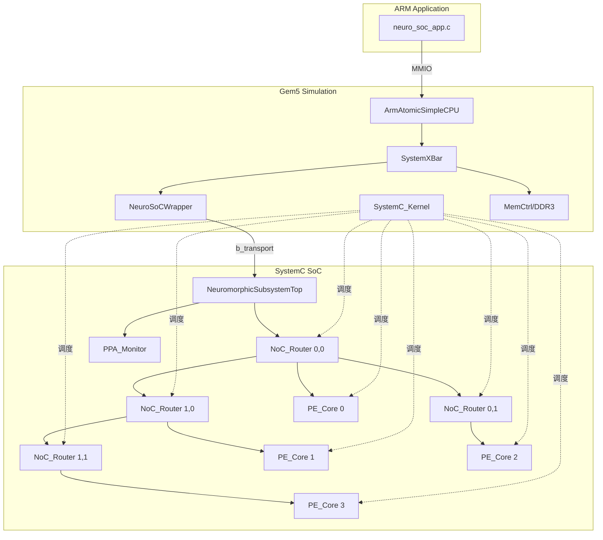

# 类脑计算多核 NoC SoC × Gem5 联合仿真项目说明

> **文档版本**：2026-06-01  
> **适用环境**：Ubuntu + Gem5 24.1.0.1 (ARM) + Gem5 内置 SystemC  
> **当前状态**：Gem5 SE 模式 MMIO 通信已打通；SystemC_Kernel 已接入；NoC 路由 + PE 计算已验证

---

## 1. 项目定位

本项目基于 **SystemC TLM-2.0**，搭建面向具身智能的 **2×2 Torus 拓扑多核类脑 SoC 事务级仿真平台**，并通过 **Gem5 ARM 仿真器** 实现软硬件协同验证：

- **软件侧**：ARM 32 位 Linux 用户态程序，通过 MMIO 寄存器配置 SoC、注入计算数据包
- **硬件侧（SystemC）**：4 个 PE 核 + 4 个 NoC 路由器 + Torus 全双工互联 + PPA 性能监控
- **桥接层（Gem5）**：`NeuroSoCWrapper` SimObject，将 CPU 总线访问转为 TLM `b_transport` 调用

**一句话**：用 Gem5 跑真实 ARM 程序，用 SystemC 跑类脑芯片内部行为，两者通过 MMIO + TLM 耦合。

---

## 2. 整体架构

### 2.1 分层视图

```
┌─────────────────────────────────────────────────────────────────┐
│  应用层   neuro_soc_app.c (ARM ELF, SE 模式)                     │
│           printf / MMIO 写寄存器 / 写数据包                       │
└────────────────────────────┬────────────────────────────────────┘
                             │ 虚拟地址 0x10000000 (process.map)
┌────────────────────────────▼────────────────────────────────────┐
│  Gem5 层  ArmAtomicSimpleCPU → SystemXBar → NeuroSoCWrapper      │
│           SystemC_Kernel (Root 级，驱动 SC 调度器)               │
└────────────────────────────┬────────────────────────────────────┘
                             │ Packet → handlePacket → b_transport
┌────────────────────────────▼────────────────────────────────────┐
│  TLM 层   NeuromorphicSubsystemTop::b_transport                 │
│           寄存器解码 / 数据包 staging / FIFO 注入                 │
└────────────────────────────┬────────────────────────────────────┘
                             │ sc_fifo + async_request_update
┌────────────────────────────▼────────────────────────────────────┐
│  SystemC  NoC_Router ×4 (SC_THREAD 路由)                        │
│           PE_Core ×4 (SC_THREAD SNN/ANN 计算)                     │
│           PPA_Monitor (纯 C++ 观察者)                            │
└─────────────────────────────────────────────────────────────────┘
```

### 2.2 仿真双引擎协作

| 引擎 | 职责 | 时间 |
|------|------|------|
| **Gem5** | CPU 取指/访存、系统总线、DRAM、Syscall 仿真 | Tick（1GHz） |
| **SystemC** | PE 计算、NoC 路由、FIFO、时钟 | `sc_time`（SoC 时钟 10ns） |
| **SystemC_Kernel** | 把 SystemC 调度器挂到 Gem5 EventQueue，使 `SC_THREAD` 真正运行 | 桥接 |

> **重要**：没有 `SystemC_Kernel` 时，只有构造函数和 `b_transport`（同步 C++ 调用）会执行；Router/PE 的 `SC_THREAD` 不会跑。

### 2.3 端到端数据流

```
ARM App
  │  SOC_MODE_REG = 0          (物理 0x10000000 + 0x0000)
  │  memcpy → SOC_DATA_FIFO    (物理 0x10000000 + 0x0200)
  ▼
Gem5 CPU (Atomic) → SystemXBar
  ▼
NeuroSoCWrapper::handlePacket()
  │  deviceOffset: 0x10000200 → 0x0200
  ▼
NeuromorphicSubsystemTop::b_transport()
  │  模式寄存器 → pe_mode_sig.write()
  │  数据包 → packet_staging → nb_write(soc_inject_fifo)
  │           → async_request_update()
  ▼
SystemC_Kernel 调度
  ▼
Router(0,0)::route_from_local() → execute_route() → Torus XY 路由
  ▼
PE_Core::process() @ sys_clk → SNN/ANN 计算 → 打印结果
```

---

## 3. 目录结构

### 3.1 核心源码（Gem5 树内）

**根路径**：`/home/ft/work/gem5/gem5source/gem5/src/MyNeuroSoC/`

| 文件 | 层级 | 说明 |
|------|------|------|
| `PE_Core.h / .cpp` | 计算核 | SNN(LIF) + ANN(MAC) 异构 PE |
| `NoC_Router.h / .cpp` | 互联 | 5 端口 Torus XY 路由 |
| `NeuromorphicSubsystemTop.h / .cpp` | 系统顶层 | TLM socket、拓扑连线、MMIO 解码 |
| `PPA_Monitor.h / .cpp` | 监控 | 无侵入 PPA 统计（头文件内联实现） |
| `NeuroSoCWrapper.h / .cpp` | Gem5 适配 | SimObject，Packet ↔ TLM 转换 |
| `NeuroSoCWrapper.py` | Gem5 配置 | SimObject Python 描述 |
| `SConscript` | 构建 | 编译规则、SystemC 头文件路径 |
| `Gem5SimulatorMock.h` | **已废弃** | 早期独立 SystemC 测试用 mock，现由 Wrapper 替代 |

**备份/历史文件**（可忽略）：`NeuroSoCWrapper copy.*`、`SConscript copy.copy`

### 3.2 测试与应用（Gem5 树外）

**根路径**：`/home/ft/work/Gem5AppTest/`

| 文件 | 说明 |
|------|------|
| `neuro_soc_test.py` | **主仿真脚本**（含 SystemC_Kernel） |
| `neuro_soc_test_atomic.py` | 早期 atomic 测试备份 |
| `neuro_soc_app.c` | ARM 测试应用程序源码 |
| `neuro_soc_app.elf` | 交叉编译产物（静态链接 ARM ELF） |
| `neuro_soc_test copy*.py` | 历史配置备份 |

### 3.3 Gem5 二进制

```
/home/ft/work/gem5/gem5source/gem5/build/ARM/gem5.opt
```

编译命令（修改 MyNeuroSoC 源码后需重新执行）：

```bash
cd /home/ft/work/gem5/gem5source/gem5
scons build/ARM/gem5.opt -j$(nproc)
```

应用交叉编译：

```bash
arm-linux-gnueabihf-gcc -static -O2 \
  -o /home/ft/work/Gem5AppTest/neuro_soc_app.elf \
  /home/ft/work/Gem5AppTest/neuro_soc_app.c
```

---

## 4. 2×2 Torus 拓扑

### 4.1 节点编号

```
        Y=1
    ┌───────┬───────┐
    │ PE 2  │ PE 3  │   id=2 (0,1)    id=3 (1,1)
    │ R(0,1)│ R(1,1)│
    ├───────┼───────┤
    │ PE 0  │ PE 1  │   id=0 (0,0)    id=1 (1,0)
    │ R(0,0)│ R(1,0)│
    └───────┴───────┘
        Y=0
      X=0     X=1
```

- `dst_id` 与节点 id 对应：`id = y * MESH_SIZE + x`，当前 `MESH_SIZE = 2`
- **外部注入点**：仅 **节点 0** 的 `rx_local` 连接 `soc_inject_fifo`（软件发包的入口）
- 节点 1/2/3 的 `rx_local` 接 dummy FIFO（占位，防止未连接报错）

### 4.2 链路规模

- **Torus 全双工链路**：16 根 `sc_fifo`（8 东西 + 8 南北，含 4 根环绕线）
- **本地链路**：4 根 Router → PE
- **注入链路**：1 根 soc_inject → Router(0,0)

### 4.3 路由算法（NoC_Router）

文件：`NoC_Router.cpp`

1. 将 `dst_id` 转为 `(dst_x, dst_y)`
2. 若目标即本节点 → `LOCAL`，交付 `tx_local`
3. 否则计算 `dx, dy`，做 **Torus 环绕最短路径**修正（`±MESH_SIZE/2` 判定）
4. **XY 路由**：先走 X（EAST/WEST），再走 Y（NORTH/SOUTH）

示例（已验证）：
- `dst=0` @ Router(0,0) → LOCAL
- `dst=3` @ Router(0,0) → EAST → Router(1,0) → NORTH → Router(1,1) → LOCAL
- `dst=2` @ Router(0,0) → NORTH → Router(0,1) → LOCAL

---

## 5. 核心数据结构

### 5.1 片上网络数据包（16 字节）

SystemC 侧（`PE_Core.h`）：

```cpp
struct DataPacket {
    int src_id;     // 源节点 id
    int dst_id;     // 目的节点 id（路由依据）
    int input_val;  // 输入脉冲强度 / ANN 特征值
    int sram_idx;   // 本地 SRAM 权重索引
};
```

ARM 应用侧（`neuro_soc_app.c`）：

```c
typedef struct __attribute__((packed)) {
    int src_id, dst_id, input_val, sram_idx;
} Gem5DataPacket;
```

两者布局一致。应用侧使用 `__attribute__((packed))` 防止 ARM 对齐导致 MMIO 写入异常。

### 5.2 MMIO 地址映射

**Gem5 物理基址**：`0x10000000`（4KB，`neuro_soc_test.py` 中配置）

**设备内偏移**（`NeuromorphicSubsystemTop::b_transport` 使用，Wrapper 会自动减基址）：

| 设备偏移 | 绝对地址 | 名称 | 访问 | 功能 |
|----------|----------|------|------|------|
| `0x0000` | `0x10000000` | `SOC_MODE_REG` | 写 32bit | PE 模式：0=SNN，1=ANN |
| `0x0100` | `0x10000100` | SRAM 权重区 | 写 | **预留**，DMA 加载权重（未实现） |
| `0x0200–0x020F` | `0x10000200` | `SOC_DATA_FIFO` | 写 16B | 注入 DataPacket 到 NoC |

**SE 模式页表映射**（必须，否则 page fault）：

```python
process.map(0x10000000, 0x10000000, 0x1000, cacheable=False)
```

---

## 6. 模块详解

### 6.1 PE_Core — 异构计算核

**文件**：`PE_Core.h`, `PE_Core.cpp`

**接口**：
- `sc_in<bool> clk` — 连接 `sys_clk`（10ns 周期）
- `sc_in<int> config_mode` — 0=SNN，1=ANN
- `sc_port<sc_fifo_in_if<DataPacket>> rx_port` — 接收数据
- `sc_port<sc_fifo_out_if<DataPacket>> tx_port` — 输出（当前接 dummy FIFO）

**近存 SRAM**：16 个 `int` 权重，构造时随机初始化 1–5（模拟预训练权重）

**SNN 模式**（`config_mode == 0`）— 简化 LIF 模型：
```
membrane_potential += input * weight
membrane_potential -= 1                    // 泄漏
if membrane_potential >= 10 → 发放脉冲，复位
```

**ANN 模式**（`config_mode == 1`）— 累加 MAC：
```
ann_accumulator += input * weight
if ann_accumulator > 15 → 输出激活值，复位
```

**进程模型**：`SC_THREAD(process)`，`sensitive << clk.pos()`，每时钟沿 `nb_read` 一次。

---

### 6.2 NoC_Router — 5 端口路由器

**文件**：`NoC_Router.h`, `NoC_Router.cpp`

**5 个输入端口**：`rx_local`, `rx_north`, `rx_south`, `rx_east`, `rx_west`  
**5 个输出端口**：`tx_local`, `tx_north`, `tx_south`, `tx_east`, `tx_west`

**5 个 SC_THREAD**（各阻塞在一个输入 FIFO 上）：
- `route_from_local / north / south / east / west`
- 均调用统一的 `execute_route()`

**扩展性**：修改 `MESH_SIZE = 4` 即可扩到 4×4=16 核（需同步扩展 Top 层连线）。

---

### 6.3 NeuromorphicSubsystemTop — SoC 顶层

**文件**：`NeuromorphicSubsystemTop.h`, `NeuromorphicSubsystemTop.cpp`

**职责**：
1. 实例化 4×PE + 4×Router + 全部 FIFO 互联
2. 提供 TLM `axi_soc_socket`（当前由 Wrapper 直接调 `b_transport`，未走 socket bind）
3. MMIO 寄存器解码
4. 挂载 `PPA_Monitor`，`monitor_clock` 线程每 SoC 时钟 tick 一次

**关键设计 — ARM 分片写入支持**：

ARM 32 位 CPU 对 16 字节结构体的 `memcpy` 会拆成 4 次 32-bit store。`b_transport` 对 `0x0200–0x020F` 范围做 **staging 缓冲**，凑满 16 字节后再注入 FIFO。

**跨域 FIFO 注入**（Gem5 上下文安全写法）：

```cpp
soc_inject_fifo->nb_write(hw_pkt);
soc_inject_fifo->async_request_update();  // 唤醒 SystemC 调度器
```

不可在 `b_transport` 里用阻塞式 `fifo->write()`（内部会 `wait()`，在非 SC 上下文不安全）。

---

### 6.4 PPA_Monitor — 性能监控

**文件**：`PPA_Monitor.h`（逻辑全在头文件 inline）

**统计项**：
- `total_clock_cycles` — SoC 时钟 tick 数
- `total_mac_ops` — 每次数据包注入计 1 次
- `total_sram_reads` — 同上
- `report()` — 仿真结束打印利用率

**调用点**：
- `perf_monitor.tick()` ← `monitor_clock` 线程
- `perf_monitor.record_compute()` ← `b_transport` 注入数据包时

> **待完善**：当前 `report()` 未在仿真结束时自动调用，需手动触发或挂到 Wrapper 析构/exit 回调。

---

### 6.5 NeuroSoCWrapper — Gem5 桥接

**文件**：`NeuroSoCWrapper.h`, `NeuroSoCWrapper.cpp`, `NeuroSoCWrapper.py`

**Gem5 SimObject**，挂到 `SystemXBar` 的 `mem_side_ports`：

```python
system.neuro_soc = NeuroSoCWrapper()
system.neuro_soc.cpu_side_port = system.membus.mem_side_ports
system.neuro_soc.addr_ranges = [AddrRange(0x10000000, 0x10000FFF)]
```

**核心方法**：

| 方法 | 作用 |
|------|------|
| `handlePacket(pkt)` | Gem5 Packet → TLM payload → `mySoc->b_transport()` |
| `deviceOffset(addr)` | 绝对地址 → 设备内偏移（减基址） |
| `init()` | 向 XBar 广播地址范围 `sendRangeChange()` |
| `CpuSidePort::recvAtomic` | atomic 模式 MMIO 入口（当前使用） |
| `CpuSidePort::recvTimingReq` | **返回 false**（timing 模式尚未实现） |

**构造时机**：`m5.instantiate()` 阶段 `new NeuromorphicSubsystemTop(...)`，此时 SystemC 模块注册到 `sc_gem5::allModules`，供 Kernel elaboration 使用。

**延迟换算**：`gem5_delay = delay.value() * 1000`（sc_time 纳秒 → Gem5 tick，1 tick = 1ps 量级，具体取决于 Gem5 配置）。

---

## 7. Gem5 仿真配置详解

**主脚本**：`gem5/src/MyNeuroSoC/AppTest/neuro_soc_test.py`（在 gem5 根目录下运行）

```python
# CPU：ARM atomic 模式（调试友好，整程序较快跑完）
system.cpu = ArmAtomicSimpleCPU()
system.mem_mode = 'atomic'

# 总线 + SoC + DRAM 三路挂载 mem_side_ports
system.neuro_soc.cpu_side_port = system.membus.mem_side_ports
system.mem_ctrl.port = system.membus.mem_side_ports

# SystemC 内核（Root 级，全局唯一）
systemc_kernel = SystemC_Kernel()
root = Root(full_system=False, system=system, systemc_kernel=systemc_kernel)

m5.instantiate()
process.map(0x10000000, 0x10000000, 0x1000, cacheable=False)
m5.simulate()
```

### 7.1 运行

```bash
./build/ARM/gem5.opt src/MyNeuroSoC/AppTest/neuro_soc_test.py
```

### 7.2 预期输出（节选）

```
[PE Init] Core 0 本地 SRAM 权重已加载。
...
[SoC Top] 2x2 Torus NoC 拓扑构建完成！16根全双工链路已打通！
[My App Test] ARM 32位交叉编译环境验证成功！
[SoC Top] 解析 AXI 指令 -> 向 PE阵列下发模式切换: 0
[SoC Top] 数据包(Dst_id:0 Val:5 Idx:0) 注入 NoC 网络...
    [Router(0,0)] 到达目的地，交付本地 PE[0]
    [Time 14440 ns] Core 0 [SNN] 读SRAM[0]权重=4, 输入=5
...
    [Router(0,0)] 路由包 Dst:3 -> EAST
    [Router(1,0)] 路由包 Dst:3 -> NORTH
    [Router(1,1)] 到达目的地，交付本地 PE[3]
    [Time 15290 ns] Core 3 [SNN] ...
```

### 7.3 测试用例逻辑（neuro_soc_app.c）

| 步骤 | 操作 | 预期 |
|------|------|------|
| 1 | `SOC_MODE_REG = 0` | 全阵列 SNN 模式 |
| 2 | 发包 dst=0, val=5 | 本地 PE0 SNN 计算 |
| 3 | 发包 dst=3, val=6 | 跨节点路由到 PE3 |
| 4 | `SOC_MODE_REG = 1` | 切换 ANN 模式 |
| 5 | 发包 dst=2, val=8 | 路由到 PE2 ANN 计算 |

---

## 8. 构建系统说明

### 8.1 SConscript 要点

```python
env.Append(CPPPATH = [
    'src/systemc',           # Gem5 内置 SystemC（必须用内置，勿链外部 libsystemc）
    'src/systemc/tlm_core',
    'src/systemc/tlm_utils',
])
env.Append(CPPDEFINES = ['SC_INCLUDE_DYNAMIC_PROCESSES'])
SimObject('NeuroSoCWrapper.py', sim_objects=['NeuroSoCWrapper'])
```

Gem5 通过 `src/SConscript` 递归扫描子目录，自动发现 `MyNeuroSoC/SConscript`。

### 8.2 SystemC 版本策略

| 环境 | 策略 |
|------|------|
| **Ubuntu / Gem5 联合仿真** | 使用 Gem5 **内置** SystemC（`src/systemc/`），不链接 `/usr/local/lib-linux64/libsystemc.a` |
| **Windows MSVC 独立仿真**（历史） | 外部 SystemC 2.3.3，Release 模式，显式 `sc_port<>` 端口 |

---

## 9. 代码阅读路线（建议顺序）

适合第一次通读项目：

1. **`neuro_soc_app.c`** — 软件视角：应用如何访问 SoC
2. **`neuro_soc_test.py`** — 仿真视角：Gem5 系统如何搭建
3. **`NeuroSoCWrapper.cpp`** — 桥接：Packet 如何变成 TLM 事务
4. **`NeuromorphicSubsystemTop.cpp`** — 顶层：`b_transport` 寄存器解码 + 拓扑连线
5. **`NoC_Router.cpp`** — 路由：Torus XY 算法
6. **`PE_Core.cpp`** — 计算：SNN/ANN 行为
7. **`PPA_Monitor.h`** — 监控：统计接口

---

## 10. 已解决的关键问题（踩坑记录）

| 问题 | 现象 | 解决方案 |
|------|------|----------|
| SE 模式无 MMIO 映射 | `Page table fault @ 0x10000000` | `process.map()` 建立 VA→PA |
| 地址偏移未转换 | 写 0x10000000 但 b_transport 判 0x0000 失败 | Wrapper `deviceOffset()` 减基址 |
| 无 SystemC_Kernel | 只有注入日志，Router/PE 不运行 | Root 挂 `SystemC_Kernel()` |
| Gem5 上下文写 FIFO | 阻塞 `write()` 不安全 | `nb_write` + `async_request_update` |
| ARM 结构体写入 | 16B 包只收到 4B | FIFO 区域 staging 缓冲 0x0200–0x020F |
| CPU 端口接错 | `REQUESTOR ↔ REQUESTOR` fatal | `dcache_port → membus.cpu_side_ports` |
| timing 模式 | `recvTimingReq` 返回 false | 暂用 atomic；timing 待实现 |

---

## 11. 当前进度与待办

### ✅ 已完成

- [x] 2×2 Torus NoC SystemC 平台（PE + Router + Top）
- [x] Gem5 `NeuroSoCWrapper` SimObject 集成
- [x] ARM SE 模式 MMIO 读写
- [x] `SystemC_Kernel` 接入，SC_THREAD 正常运行
- [x] 端到端：App → MMIO → NoC 路由 → PE 计算
- [x] SNN / ANN 模式动态切换

### 🔲 待完善（建议优先级）

| 优先级 | 任务 | 说明 |
|--------|------|------|
| P0 | Timing 模式 | 实现 `recvTimingReq`，切换 `ArmTimingSimpleCPU` |
| P1 | PPA 报告自动输出 | 仿真结束时调用 `perf_monitor.report()` |
| P1 | PE 输出回读 | 目前 `tx_port` 接 dummy FIFO，软件无法读结果 |
| P2 | SRAM 权重 DMA | 实现 `0x0100` 区域加载真实权重 |
| P2 | 多注入点 | 不仅节点 0，支持各 PE 本地注入 |
| P3 | 扩展 4×4 | `MESH_SIZE=4`，16 核 Torus 连线 |
| P3 | 清理备份文件 | 删除 `copy` 后缀的历史文件 |

---

## 12. 关键参数速查

| 参数 | 值 | 位置 |
|------|-----|------|
| Gem5 版本 | 24.1.0.1 | `build/ARM/gem5.opt` |
| CPU 时钟 | 1 GHz | `neuro_soc_test.py` |
| SoC 时钟 | 10 ns (100 MHz) | `NeuromorphicSubsystemTop` 构造函数 |
| SoC MMIO 基址 | 0x10000000 | Python + App |
| SoC MMIO 大小 | 4 KB | `AddrRange` |
| PE 数量 | 4 | `PE_NUM = 4` |
| Mesh 规模 | 2×2 | `NoC_Router::MESH_SIZE` |
| PE SRAM 深度 | 16 | `PE_Core::SRAM_SIZE` |
| SNN 阈值 | 10 | `PE_Core.cpp` |
| ANN 激活阈值 | 15 | `PE_Core.cpp` |
| inject FIFO 深度 | 8 | `soc_inject_fifo` |
| TLM 总线延迟 | 20 ns | `b_transport` |

---

## 13. 附录：模块依赖关系图



---

## 14. 快速命令备忘

```bash
# 1. 编译 Gem5（改 C++ 后）
cd /home/ft/work/gem5/gem5source/gem5 && scons build/ARM/gem5.opt -j$(nproc)

# 2. 编译 ARM 应用（改 .c 后）
arm-linux-gnueabihf-gcc -static -O2 \
  -o /home/ft/work/Gem5AppTest/neuro_soc_app.elf \
  /home/ft/work/Gem5AppTest/neuro_soc_app.c

# 3. 运行联合仿真
./build/ARM/gem5.opt src/MyNeuroSoC/AppTest/neuro_soc_test.py
```

---

*本文档随代码演进更新。下一步建议从 **Timing 模式** 或 **PPA 报告自动输出** 开始完善。*
